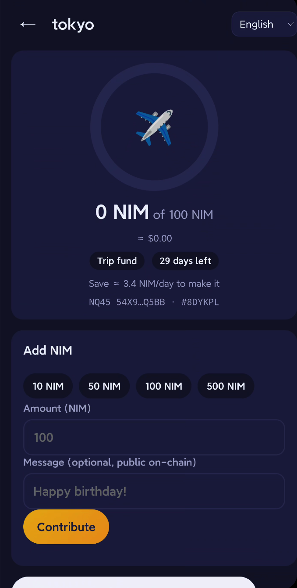
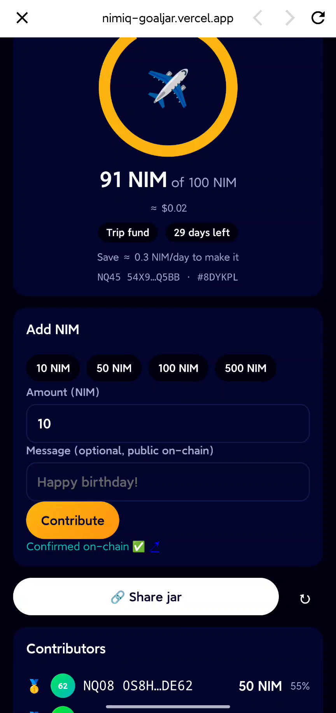
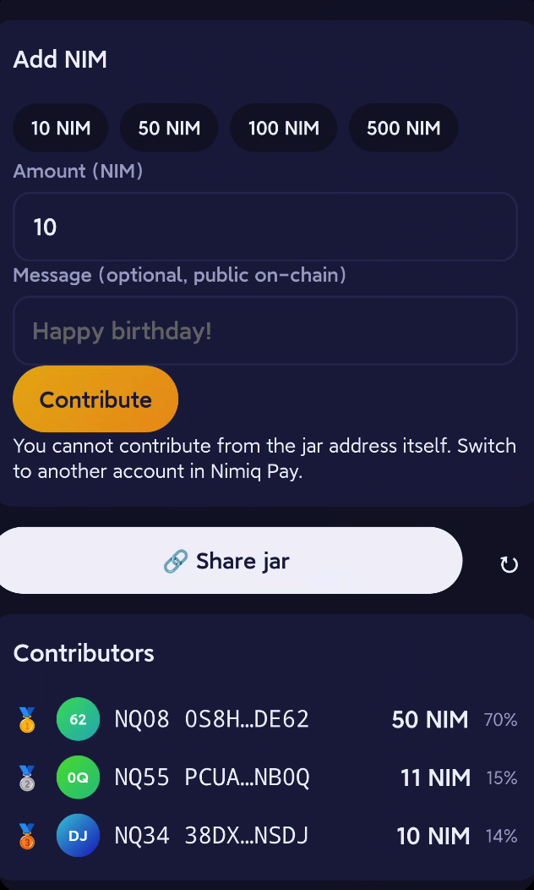
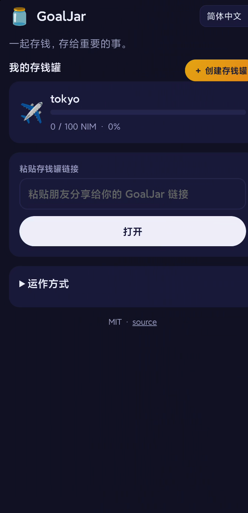

# GoalJar 🫙 Save together on Nimiq Pay

GoalJar is a Nimiq Pay Mini App for **shared savings goals**: group gifts, trip funds, Lunar New Year red-packet pools, and personal "vaults".

- **Non-custodial and no backend.** A jar is a Nimiq address plus a goal. The jar's settings travel inside the share link.
- **On-chain progress.** Every contribution is a normal NIM payment (`sendBasicTransactionWithData`) tagged `GJ:<jarId>:<message>`. The app reads progress from the chain via `getTransactionsByAddress`.
- **Social.** Share a deep link (`https://nimpay.app/miniapps/open/...`), see a contributor leaderboard, an activity feed with messages, milestone confetti, a "save X NIM/day" pace hint, and saving streaks.
- **5 languages.** English, 繁體中文, 简体中文, Español, Deutsch. The default follows `window.nimiqPay.language`.
- **Testnet aware.** Uses `getHostNetwork()` to pick the mainnet or testnet RPC and explorer.

## Demo

▶️ **[Watch the 26 s demo video (docs/demo.mp4)](docs/demo.mp4)**: a real screen recording on a phone. GoalJar opens from Nimiq Pay → Mini Apps, the jar "tokyo" is at 81/100 NIM, the user contributes 10 NIM, approves with Connect + Confirm in Nimiq Pay, sees "Sent! Waiting for confirmation…" and then "Confirmed on-chain ✅". The total goes to 91 NIM and the contributor list updates.

Live app: **https://nimiq-goaljar.vercel.app** (open it inside Nimiq Pay → Mini Apps).

| Jar | Confirmed on-chain | Contributors | 简体中文 |
|---|---|---|---|
|  |  |  |  |

**Tested on a real device (2026-11-02).** The full flow ran inside the Nimiq Pay app on **testnet**: creating a jar, contributing from several accounts, native Nimiq Pay approval, on-chain confirmation, and progress plus the leaderboard read back from the chain. The contributions shown above are real testnet transactions to the jar address.

## Develop
```bash
npm install
npm run dev          # http://<your-LAN-ip>:5173, then load it in Nimiq Pay (Settings → Mini Apps → developer/local)
npm run build        # outputs static files in dist/
```
Requires Node 20+.

### Deploy
Deploy `dist/` to any static host (Vercel, Netlify, Cloudflare Pages, GitHub Pages). On Vercel or Cloudflare Pages: import this repo, framework **Vite**, build command `npm run build`, output directory `dist`. Optionally set `VITE_REPO_URL` (see `.env.example`; defaults to this repo).

Then open the https URL inside Nimiq Pay (Mini Apps → custom URL). Test on testnet first (Nimiq Pay dev menu → Testnet → get free NIM).

## How a contribution works
1. The user taps **Contribute**. Nimiq Pay shows its native approval for a NIM payment to the jar address, with data `GJ:ABC234:Happy birthday!`. The data is at most 64 bytes and is public.
2. The app polls `getTransactionByHash` until the payment is confirmed, then re-reads the jar.
3. Progress is the sum of successful incoming transactions to the jar address whose data starts with `GJ:<jarId>`.

Note: Nimiq does not allow sending to the same address that signs the transaction. For a personal vault, use a second address you own as the jar.

## License
MIT
